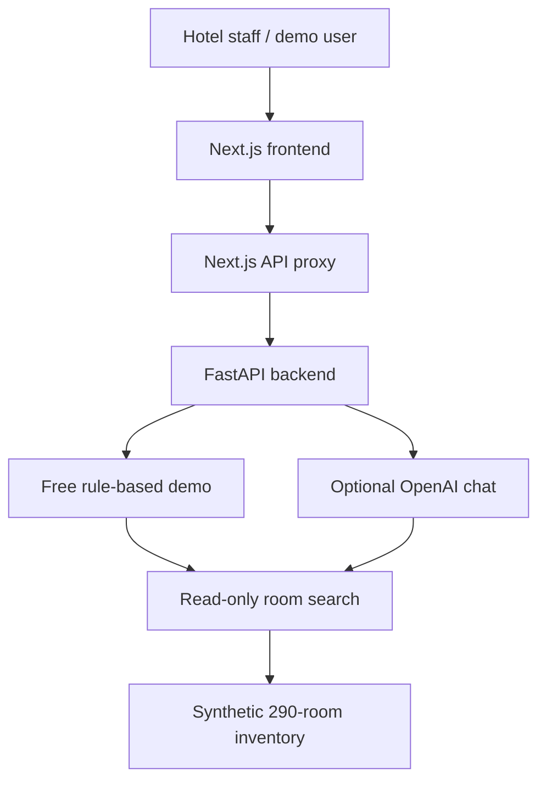

# StayPilot AI

**A hotel operations dashboard and AI copilot prototype built with Next.js, TypeScript, Python, and FastAPI.**

StayPilot AI explores how hotel teams could combine room inventory, operational information, and conversational tools in a single workspace. It includes a working, no-cost inventory demo and a separate OpenAI-powered chat integration that can be enabled with an API key.

> **Project status:** Portfolio prototype using synthetic demonstration data. Not connected to a live hotel property-management system.

## What it does

- **Hotel dashboard:** Displays sample reservation and operational metrics.
- **Room management:** Browses a structured, 290-room synthetic inventory.
- **Room filtering:** Supports floors, room categories, views, accessibility, sofa beds, and suites through a read-only search API.
- **Free Demo Copilot:** Answers supported inventory questions through a deterministic, rule-based Python service. No OpenAI key or paid AI API calls are required.
- **Conversation follow-ups:** Handles selected follow-up questions, such as asking which room categories are on a previously discussed floor.
- **Optional OpenAI Copilot:** Includes a server-side OpenAI Responses API integration with read-only inventory tool calling. Requires separate configuration and has not been enabled for the free demo.

## Demo questions

The Free Demo supports examples including:

- `How many rooms are in the hotel?`
- `How many river-view rooms are on floor 19?`
- `How many rooms are on the 5th floor?`
- `How many river view on 5th floor?`
- `What kind?` (after a room-inventory question)
- `How many accessible rooms?`

The synthetic hotel contains **290 rooms**. For example, a floor-19 river-view query returns **1905, 1906, 1907, and 1920**.

Inventory matches do **not** mean that rooms are available to reserve.

## Technology stack

| Layer | Technologies |
| --- | --- |
| Frontend | Next.js 16, React 19, TypeScript, Tailwind CSS |
| Backend | Python, FastAPI, Pydantic, Uvicorn |
| Optional AI | OpenAI Responses API with function calling |
| Data | In-memory synthetic room inventory and sample reservations |
| Testing | Python unittest and FastAPI TestClient |
| Version control | Git and GitHub |

## Architecture



The free demo is a deterministic inventory assistant, not a generative language model. It can answer the question patterns implemented in the backend but does not understand arbitrary conversations.

The optional OpenAI mode uses a server-side API key and a read-only room-search tool. It does not perform reservations or modify inventory.

## Project structure

```text
staypilot-ai/
├── backend/
│   ├── main.py
│   ├── hotel_config.py
│   ├── room_inventory.py
│   ├── copilot_tools.py
│   ├── copilot_api.py
│   ├── copilot_demo.py
│   ├── copilot_chat.py
│   ├── tests/
│   └── requirements.txt
├── frontend/
│   ├── src/app/
│   │   ├── api/copilot/
│   │   ├── copilot/
│   │   └── rooms/
│   └── package.json
└── README.md
```

## Run locally

### Requirements

- Python 3.12 or another compatible Python 3 version
- Node.js and npm
- Git

### 1. Clone the repository

```powershell
git clone https://github.com/ayushvamja97/staypilot-ai.git
cd staypilot-ai
```

### 2. Set up the backend

From the project root:

```powershell
cd backend
python -m venv .venv
.\.venv\Scripts\python.exe -m pip install -r requirements.txt
```

Start FastAPI on port 8002:

```powershell
.\.venv\Scripts\python.exe -m uvicorn main:app --host 127.0.0.1 --port 8002
```

Leave this terminal running.

Backend documentation: http://127.0.0.1:8002/docs

### 3. Start the frontend

Open a second PowerShell terminal in the project root:

```powershell
cd frontend
npm install
npm run dev -- -p 3001
```

Open:

- Dashboard: http://localhost:3001
- Room management: http://localhost:3001/rooms
- Copilot: http://localhost:3001/copilot

Select **Free Demo** in the Copilot interface. It uses the backend on port 8002 by default.

### 4. Optional backend configuration

Both Next.js chat proxies support the server-side environment variable:

```text
STAYPILOT_BACKEND_ORIGIN
```

Set it to the backend origin (without an API route suffix) when running the backend at a different address.

The OpenAI mode requires `OPENAI_API_KEY` to be configured on the FastAPI server. API usage can incur charges. Do not put API keys in frontend code or commit them to Git.

Without an API key, the free demo still works.

## Test the backend

From the project root, with dependencies installed:

```powershell
.\backend\.venv\Scripts\python.exe -m unittest discover -s backend/tests -q
```

The existing test suite covers inventory behavior, API responses, supported natural-language questions, selected conversation follow-ups, and safeguards against implying live availability.

**Latest local verification:** 35 backend tests passed.

## API endpoints

| Endpoint | Method | Description |
| --- | --- | --- |
| `/api/health` | GET | Backend health |
| `/api/dashboard` | GET | Sample operational metrics |
| `/api/reservations` | GET | Sample reservations |
| `/api/rooms` | GET | Inventory listing |
| `/api/copilot/rooms/search` | GET | Filtered, read-only room search |
| `/api/copilot/demo-chat` | POST | Free rule-based room assistant |
| `/api/copilot/chat` | POST | Optional OpenAI-assisted chat |

These paths are served by FastAPI. The Next.js frontend also exposes chat proxy routes.

## Data and safety limitations

- All displayed hotel records are synthetic demonstration data.
- Room attributes and counts are not live property-management information.
- Room availability, housekeeping status, maintenance status, and reservation operations are not connected to real hotel systems.
- The Free Demo handles a defined set of room-related queries, not arbitrary hotel policies or operational questions.
- The application is a portfolio prototype, not a production-ready hotel system.
- Authentication, real PMS integrations, deployment configuration, and production monitoring require additional work.

## Roadmap

- Expand conversational understanding and test coverage.
- Improve the Copilot experience and supported questions.
- Add documented, verified operational knowledge sources.
- Prepare hosted deployment with environment-based configuration.
- Add screenshots, automated checks, and further accessibility testing.

## Development

Built as a full-stack portfolio project demonstrating API design, React and TypeScript development, Python backend engineering, structured data modeling, automated testing, and optional AI tool integration.